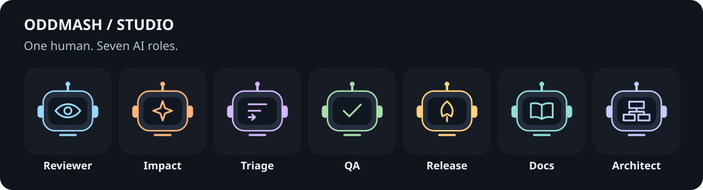

# Oddmash

[English](../../profile/README.md) · [한국어](../ko/README.md) · **日本語** · [简体中文](../zh-CN/README.md)

Oddmash は七つの専門AIアドバイザーと開発者ツールやWebサービスを作る、一人の独立系スタジオです。製品の判断とリリースはメンテナーが担います。

## AIエージェント

- **Reviewer**: コードの具体的な問題を確認します。
- **Impact**: 製品価値と変更の必要性を評価します。
- **Triage**: 課題を分類し、優先順位を提案します。
- **QA**: テスト範囲と実行結果を分析します。
- **Release**: リリースノートと互換性の案内を作ります。
- **Docs**: コードと文書の不一致を確認します。
- **Architect**: 設計と保守性を評価します。

Reviewerのみ自動実行します。他の役割はメンテナーの明示的な依頼に応じ、独立したリリースやマージを行いません。

## 公開プロジェクト

- [Kowrap](https://github.com/Oddmash/kowrap): Web上の自然な韓国語の改行。
- [Oddmash UI](https://github.com/Oddmash/oddmash-ui): アクセシブルなReactコンポーネントとトークン。
- [Interaction Inspector](https://github.com/Oddmash/interaction-inspector): ChromeでDOMイベントとフォーカスを調べる。
- [Boundra](https://github.com/Oddmash/boundra): TypeScriptのドメイン境界を検査する。

公開プロジェクトでは具体的な問題報告や改善提案を歓迎します。[コントリビューションガイド](CONTRIBUTING.md)をご覧ください。
