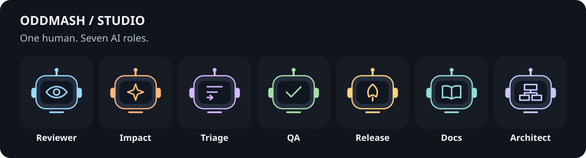

# Oddmash

[English](../../profile/README.md) · **한국어** · [日本語](../ja/README.md) · [简体中文](../zh-CN/README.md)

Oddmash는 일곱 역할의 AI 에이전트와 개발 도구 및 웹 서비스를 만드는 1인 독립 스튜디오입니다. 제품 결정과 릴리스의 책임은 메인테이너에게 있습니다.

## 에이전트

- **Reviewer**: 코드의 구체적인 결함을 점검합니다.
- **Impact**: 제품 가치와 변경 필요성을 평가합니다.
- **Triage**: 이슈를 분류하고 우선순위를 제안합니다.
- **QA**: 테스트 범위와 확인된 결과를 분석합니다.
- **Release**: 릴리스 노트와 호환성 안내를 작성합니다.
- **Docs**: 문서와 코드의 불일치를 찾습니다.
- **Architect**: 설계과 유지보수성을 평가합니다.

Reviewer만 자동 실행합니다. 다른 역할은 메인테이너의 명시적인 요청에 응답하며, 독립적인 릴리스나 머지 권한을 부여하지 않습니다.

## 공개 프로젝트

- [Kowrap](https://github.com/Oddmash/kowrap): 웹의 자연스러운 한국어 줄바꿈.
- [Oddmash UI](https://github.com/Oddmash/oddmash-ui): 접근성을 고려한 React 컴포넌트와 디자인 토큰.
- [Interaction Inspector](https://github.com/Oddmash/interaction-inspector): Chrome의 DOM 이벤트 및 키보드 포커스 검사.
- [Boundra](https://github.com/Oddmash/boundra): TypeScript 도메인 경계 검사.

공개 프로젝트에는 구체적인 문제 제보와 개선 제안을 환영합니다. [기여 가이드](CONTRIBUTING.md)를 확인해 주세요.
