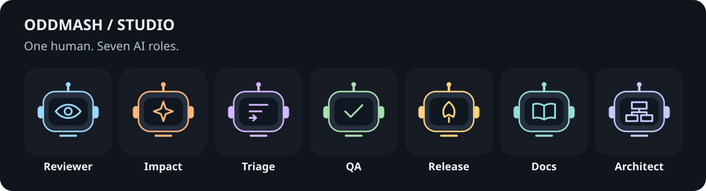

# Oddmash

[English](../../profile/README.md) · [한국어](../ko/README.md) · [日本語](../ja/README.md) · **简体中文**

Oddmash 是由一位开发者运营的独立工作室，借助七个专业 AI 顾问构建开发工具和 Web 服务。产品决策与发布由维护者负责。

## 智能体团队

- **Reviewer**: 审查代码并指出具体问题。
- **Impact**: 评估产品价值和变更必要性。
- **Triage**: 分类问题并建议优先级。
- **QA**: 分析测试覆盖及检查结果。
- **Release**: 起草发布说明和兼容性指南。
- **Docs**: 检查代码与文档的一致性。
- **Architect**: 评估设计和可维护性。

只有 Reviewer 自动运行。其他角色响应维护者的明确请求，不独立发布或合并代码。

## 公开项目

- [Kowrap](https://github.com/Oddmash/kowrap): 适用于 Web 的自然韩语换行。
- [Oddmash UI](https://github.com/Oddmash/oddmash-ui): 无障碍 React 组件与设计令牌。
- [Interaction Inspector](https://github.com/Oddmash/interaction-inspector): 在 Chrome 中检查 DOM 事件及焦点。
- [Boundra](https://github.com/Oddmash/boundra): 检查 TypeScript 的领域边界。

公开项目欢迎具体的问题报告及改进建议。请参阅[贡献指南](CONTRIBUTING.md)。
