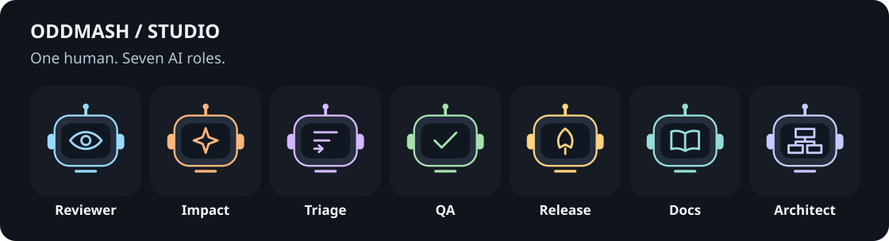

# Oddmash

**English** · [한국어](https://github.com/Oddmash/.github/blob/main/docs/ko/README.md) · [日本語](https://github.com/Oddmash/.github/blob/main/docs/ja/README.md) · [简体中文](https://github.com/Oddmash/.github/blob/main/docs/zh-CN/README.md)

Oddmash is an independent, one-person software studio building developer tools and web experiences with seven specialized AI advisors. The maintainer owns product decisions and releases.

## Agent family

- **Reviewer**: Reviews code and identifies actionable regressions.
- **Impact**: Evaluates product value and trade-offs.
- **Triage**: Classifies issues and suggests priorities.
- **QA**: Assesses test coverage and reported checks.
- **Release**: Drafts release notes and compatibility guidance.
- **Docs**: Finds documentation gaps.
- **Architect**: Evaluates design and maintainability.

Reviewer runs automatically. Other roles respond to explicit maintainer requests. They provide advice, not independent release or merge authorization.

## Public projects

- [Kowrap](https://github.com/Oddmash/kowrap): Natural Korean line breaking for the web.
- [Oddmash UI](https://github.com/Oddmash/oddmash-ui): Accessible React components and design tokens.
- [Interaction Inspector](https://github.com/Oddmash/interaction-inspector): Inspect DOM events and keyboard focus in Chrome.
- [Boundra](https://github.com/Oddmash/boundra): Enforce domain boundaries in TypeScript.

Public projects welcome focused issue reports and concrete improvements. Read the [contribution guide](https://github.com/Oddmash/.github/blob/main/CONTRIBUTING.md).
